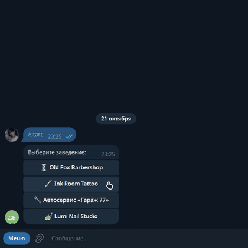
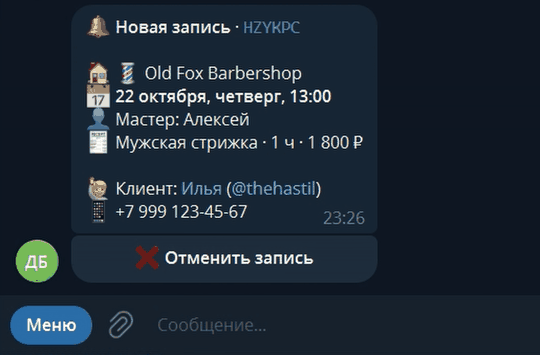
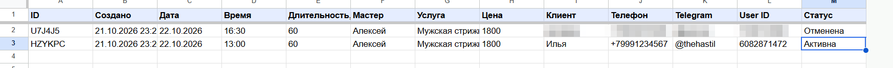
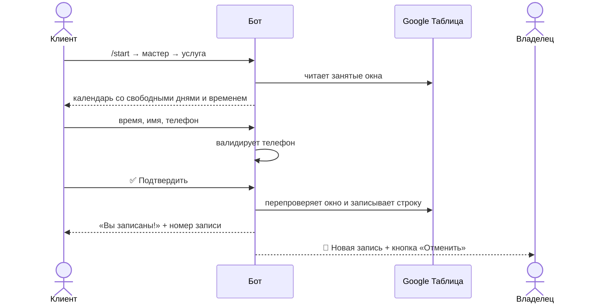

<div align="center">

# 📅 Telegram-бот онлайн-записи

**Запись клиентов к мастерам 24/7 — с проверкой свободных окон, Google Таблицей и мгновенными уведомлениями владельцу**

Барбершоп · Тату-салон · Ногтевая студия · Автосервис — и любой бизнес, где есть мастер, услуга и время

<br>

[](https://t.me/Demohastil_bot)

<br>


</div>

---

## 🎬 Демо

<table>
  <tr>
    <td align="center" width="50%"><b>Клиент записывается</b></td>
    <td align="center" width="50%"><b>Владелец получает уведомление</b></td>
  </tr>
  <tr>
    <td align="center"></td>
    <td align="center"></td>
  </tr>
</table>

<p align="center"><b>Каждая запись сразу попадает в Google Таблицу</b></p>
<p align="center"></p>

> 💡 Откройте [@Demohastil_bot](https://t.me/Demohastil_bot) и запишитесь сами: в демо-режиме после записи вы увидите копию уведомления, которое получает владелец.

---

## 💼 Какие проблемы бизнеса решает

| 😩 Было | ✅ Стало |
|---|---|
| Администратор часами переписывается «а есть время в субботу?» | Клиент видит только реально свободные окна и записывается сам — даже ночью |
| Двое записались на одно время | Бот перепроверяет окно в момент подтверждения — двойная запись невозможна |
| Неправильный номер телефона в записи | Номер проверяется по базе libphonenumber, можно отправить его одной кнопкой |
| Записи в блокноте или «в голове» | Всё в Google Таблице: видно с телефона, легко фильтровать и считать выручку |
| Клиент передумал и просто не пришёл | Отмена в два нажатия, владелец сразу узнаёт, окно снова доступно |

---

## ✨ Возможности

<table>
<tr>
<td valign="top" width="50%">

### 🙋 Для клиента

- 🧭 Пошаговая запись: **мастер → услуга → день → время**
- 💰 Цена и длительность каждой услуги видны сразу
- 📆 Календарь на 14 дней: выходные и занятые дни видны, но не нажимаются
- ⏱ Только реальные окна — с учётом графика, перерывов и длительности услуги
- 📱 Телефон одной кнопкой или вручную в любом формате
- 🗂 «Мои записи» и отмена в два нажатия
- ⬅️ Кнопка «Назад» на каждом шаге

</td>
<td valign="top" width="50%">

### 👑 Для владельца

- 🔔 Мгновенное уведомление о новой записи в личку
- ❌ Отмена записи прямо из уведомления — клиенту уйдёт сообщение
- 📭 Алерт, когда клиент отменил запись
- 📋 `/today` — расписание на день, листается ◀️ ▶️
- 📊 Google Таблица как админка: смена статуса на «Отменена» освобождает окно
- 🚫 Строка с мастером «Все» закрывает время для всего салона
- 🏢 Несколько заведений в одном боте

</td>
</tr>
</table>

### ⚙️ Под капотом

- **Новая ниша = один JSON-файл** в `presets/` — мастера, услуги, цены, график. Код не трогаем
- **Защита от гонок:** `asyncio.Lock` + повторная проверка слота перед записью
- **Анти-спам:** лимит активных записей на одного клиента
- **Бережём лимиты Google API:** кэширование чтений, все вызовы gspread вынесены из event loop
- **Stateless-навигация:** весь выбор зашит в callback-кнопки — «Назад» работает даже после перезапуска
- **Валидация пресетов при старте:** опечатка в id услуги или смена «с 19:00 до 10:00» — понятная ошибка, а не падение в проде
- **31 автотест**, включая сквозной прогон всего диалога через диспетчер aiogram

---

## 🔄 Как это работает



---

## 🛠 Стек

| | |
|---|---|
| **Язык** | Python 3.10+ (asyncio) |
| **Telegram** | aiogram 3 — FSM, CallbackData, роутеры, middleware-injection |
| **Хранилище** | Google Sheets API (gspread) или локальный JSON для разработки |
| **Телефоны** | phonenumbers (порт Google libphonenumber) |
| **Тесты** | pytest, pytest-asyncio |
| **Деплой** | Docker, docker compose |

---

## 🚀 Быстрый старт

> Запуск за 5 минут, Google-аккаунт не нужен — записи сохранятся в локальный файл.

**1. Получите токен** у [@BotFather](https://t.me/BotFather) → `/newbot`.

**2. Установите зависимости:**

```bash
git clone https://github.com/hastilkas/booking-bot.git
cd booking-bot
python -m venv .venv
.venv\Scripts\activate          # Windows
# source .venv/bin/activate     # Linux / macOS
pip install -r requirements.txt
```

**3. Настройте окружение:** скопируйте `.env.example` в `.env` и впишите `BOT_TOKEN`.

**4. Запустите:**

```bash
python -m bot
```

**5. Станьте владельцем:** отправьте боту `/id`, впишите число в `OWNER_IDS` в `.env` и перезапустите бота — теперь уведомления приходят вам.

---

## 📊 Подключение Google Таблицы

<details>
<summary><b>Пошаговая инструкция (≈ 7 минут)</b></summary>

<br>

1. Откройте [Google Cloud Console](https://console.cloud.google.com/) и создайте проект.
2. **APIs & Services → Library** — включите **Google Sheets API** и **Google Drive API**.
3. **APIs & Services → Credentials → Create credentials → Service account** — создайте аккаунт (роли не нужны).
4. Откройте аккаунт → **Keys → Add key → Create new key → JSON**. Положите файл в корень проекта как `credentials.json`.
5. Создайте пустую Google Таблицу и через **«Настройки доступа»** выдайте права **Редактор** на email сервисного аккаунта (`…@….iam.gserviceaccount.com`, поле `client_email` в `credentials.json`).
6. Скопируйте ID таблицы из ссылки: `docs.google.com/spreadsheets/d/`**`ВОТ_ЭТО`**`/edit`
7. В `.env`:
   ```env
   STORAGE=sheets
   SPREADSHEET_ID=ВОТ_ЭТО
   ```
8. Проверьте подключение — скрипт подскажет, что не так:
   ```bash
   python -m bot.check_sheets
   ```
9. Перезапустите бота. Для каждого заведения он сам создаст лист с заголовками.

</details>

<details>
<summary><b>Управление записями прямо из таблицы</b></summary>

<br>

| Действие | Что сделать в таблице |
|---|---|
| Отменить запись | Поменять «Статус» на любое значение, начинающееся с `Отмен…` |
| Закрыть время у мастера | Добавить строку: дата `25.10.2026`, время `14:00`, длительность `120`, мастер `Алексей` |
| Закрыть время у всех | То же самое, но в колонке «Мастер» написать `Все` |

Бот перечитывает таблицу каждые ~10 секунд.

</details>

---

## 🎨 Настройка под своё заведение

<details>
<summary><b>Пример пресета <code>presets/mysalon.json</code></b></summary>

<br>

```json
{
  "id": "mysalon",
  "name": "Мой салон",
  "emoji": "💇",
  "description": "Стрижки и окрашивание в центре города",
  "address": "ул. Ленина, 1",
  "phone": "+7 (900) 000-00-00",
  "slot_step_minutes": 30,
  "services": [
    {"id": "cut", "title": "Стрижка", "duration": 60, "price": 1500},
    {"id": "color", "title": "Окрашивание", "duration": 180, "price": 5000}
  ],
  "masters": [
    {
      "id": "anna",
      "name": "Анна",
      "about": "Стилист-колорист, 5 лет опыта",
      "services": ["cut", "color"],
      "schedule": {"mon": ["10:00", "19:00"], "sat": ["11:00", "17:00"]},
      "breaks": [["14:00", "15:00"]]
    }
  ]
}
```

Затем в `.env`: `PRESETS=mysalon`.

</details>

Готовые пресеты: `barbershop` · `tattoo` · `nails` · `autoservice`

---

## 🔧 Переменные окружения

| Переменная | По умолчанию | Описание |
|---|---|---|
| `BOT_TOKEN` | — | Токен от @BotFather **(обязательно)** |
| `OWNER_IDS` | — | Telegram ID владельцев через запятую (узнать: `/id`) |
| `PRESETS` | `barbershop` | Пресеты заведений через запятую |
| `STORAGE` | `local` | `local` — JSON-файл, `sheets` — Google Таблица |
| `SPREADSHEET_ID` | — | ID Google Таблицы (для `sheets`) |
| `GOOGLE_CREDENTIALS_FILE` | `credentials.json` | Путь к ключу сервисного аккаунта |
| `TIMEZONE` | `Europe/Moscow` | Часовой пояс заведения |
| `BOOKING_DAYS_AHEAD` | `14` | На сколько дней вперёд открыта запись |
| `MIN_LEAD_MINUTES` | `60` | Минимум минут от «сейчас» до записи |
| `MAX_ACTIVE_PER_USER` | `3` | Лимит активных записей на клиента |
| `PHONE_REGION` | `RU` | Регион для номеров без кода страны |
| `DEMO_MODE` | `false` | Клиент видит копию уведомления владельца |

---

## 🐳 Деплой на сервер

Подойдёт любой VPS с Docker — хватит самого дешёвого тарифа.

```bash
git clone https://github.com/hastilkas/booking-bot.git && cd booking-bot
cp .env.example .env && nano .env
docker compose up -d --build
docker compose logs -f
```

Для Google Таблицы положите `credentials.json` рядом и раскомментируйте строку с ним в `docker-compose.yml`.

---

## 🧪 Тесты

```bash
pip install -r requirements-dev.txt
pytest
```

Покрыто: расчёт слотов и перерывов, валидация телефонов, гонка двух клиентов за одно окно, лимиты, отмены, формат строк Google Таблицы и **полный диалог записи** от `/start` до уведомления владельцу.

---

## 📁 Структура проекта

```
bot/
├── __main__.py          # точка входа, сборка зависимостей
├── config.py            # настройки из .env
├── catalog.py           # загрузка и валидация пресетов
├── slots.py             # расчёт свободных окон (чистые функции)
├── booking_service.py   # бизнес-логика: окна, запись, отмена, лимиты
├── phone.py             # валидация и нормализация телефонов
├── check_sheets.py      # диагностика подключения к Google Таблице
├── keyboards.py         # клавиатуры и callback-данные
├── texts.py             # все тексты в одном месте
├── handlers/            # сценарии клиента и владельца
└── storage/             # Google Sheets и локальный JSON с общим интерфейсом
presets/                 # barbershop · tattoo · nails · autoservice
tests/                   # unit + e2e тесты
```

---

## 🗺 Можно добавить под заказчика

- [ ] Напоминания клиенту за 24 ч и 2 ч до визита
- [ ] Онлайн-предоплата (ЮKassa / Telegram Payments)
- [ ] Запись к «любому свободному мастеру»
- [ ] Отзывы после визита и повторная запись в один клик
- [ ] Синхронизация с Google Calendar мастера
- [ ] Веб-админка со статистикой

---

<div align="center">

**Нужен такой бот для вашего бизнеса?** Напишите мне — адаптирую под вашу нишу, график и процессы.

[](https://t.me/thehastil)

</div>
